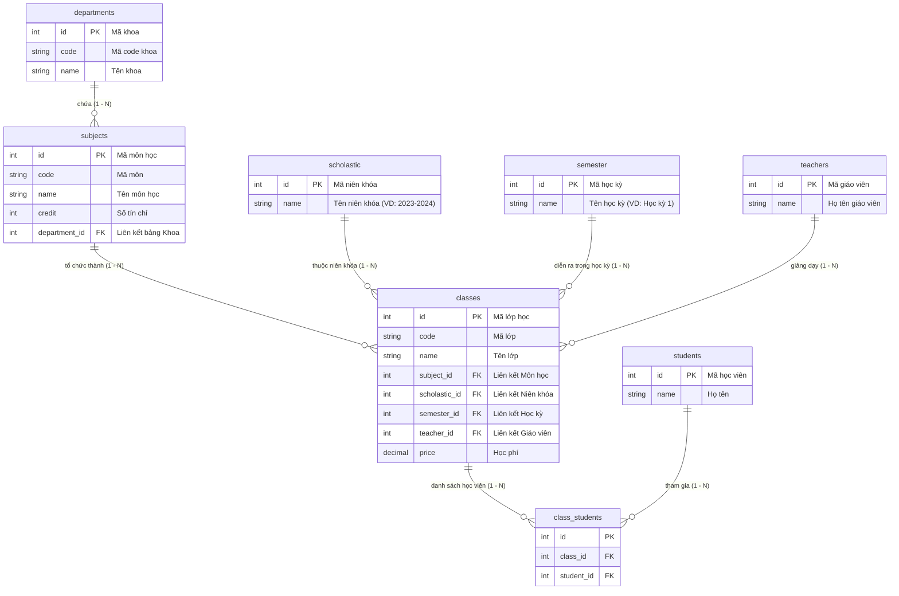

# Academy GPSG - Hệ Thống Quản Lý Đào Tạo

Hệ thống backend quản lý đào tạo, học viện, khoa, môn học, lớp học và học viên được xây dựng trên nền tảng **NestJS**, **TypeORM** và **MySQL/PostgreSQL**.

---

## 📋 Mục lục

- [1. Giới thiệu hệ thống](#1-giới-thiệu-hệ-thống)
- [2. Công nghệ sử dụng](#2-công-nghệ-sử-dụng)
- [3. Cấu trúc cơ sở dữ liệu & Sơ đồ ERD](#3-cấu-trúc-cơ-sở-dữ-liệu--sơ-đồ-erd)
- [4. Cấu trúc thư mục dự án](#4-cấu-trúc-thư-mục-dự-án)
- [5. Hướng dẫn cài đặt & Khởi chạy](#5-hướng-dẫn-cài-đặt--khởi-chạy)
- [6. Tài liệu API (Swagger)](#6-tài-liệu-api-swagger)

---

## 1. Giới thiệu hệ thống

Dự án **Academy GPSG** cung cấp giải pháp toàn diện cho việc quản lý các hoạt động giáo dục và đào tạo bao gồm:
- Quản lý cơ cấu đào tạo: **Khoa**, **Môn học**, **Niên khóa**, **Học kỳ**.
- Quản lý **Lớp học**, lịch học, điểm danh, đề thi và phòng học.
- Quản lý **Giảng viên**, **Học viên**, việc đăng ký học (`Enrollments`) và tài chính/học phí.
- Tính năng mở rộng: Bài học online, bài tập về nhà, đánh giá giảng viên, thông báo.

---

## 2. Công nghệ sử dụng

- **Core Framework:** [NestJS](https://nestjs.com/) (Node.js framework)
- **ORM:** [TypeORM](https://typeorm.io/)
- **Database:** MySQL / PostgreSQL
- **Authentication:** Passport JWT & Local strategy
- **Tài liệu API:** Swagger UI (`@nestjs/swagger`)
- **File Storage:** AWS S3 / Cloudinary
- **Logging:** Winston (`nest-winston`)

---

## 3. Cấu trúc cơ sở dữ liệu & Sơ đồ ERD

### Sơ đồ ERD mối quan hệ các bảng chính (Khoa, Môn học, Lớp học, Niên khóa, Học kỳ)



### Chi tiết các mối quan hệ cốt lõi:
1. **Khoa (`Department`) $\rightarrow$ Môn học (`Subject`):** `1 - N`. Một khoa quản lý nhiều môn học. Khóa ngoại `subjects.department_id`.
2. **Môn học (`Subject`) $\rightarrow$ Lớp học (`Classes`):** `1 - N`. Một môn học được mở thành nhiều lớp học. Khóa ngoại `classes.subject_id`.
3. **Niên khóa (`Scholastic`) $\rightarrow$ Lớp học (`Classes`):** `1 - N`. Một niên khóa chứa nhiều lớp học. Khóa ngoại `classes.scholastic_id`.
4. **Học kỳ (`Semester`) $\rightarrow$ Lớp học (`Classes`):** `1 - N`. Một học kỳ diễn ra nhiều lớp học. Khóa ngoại `classes.semester_id`.

---

## 4. Cấu trúc thư mục dự án

```text
src/
├── modules/
│   ├── departments/          # Quản lý Khoa (departments.entity.ts)
│   ├── subjects/             # Quản lý Môn học (subjects.entity.ts)
│   ├── class/                # Quản lý Lớp học (class.entity.ts)
│   │   ├── _scholastic/      # Quản lý Niên khóa (scholastic.entity.ts)
│   │   └── _semester/        # Quản lý Học kỳ (semester.entity.ts)
│   ├── teachers/             # Quản lý Giảng viên
│   ├── students/             # Quản lý Học viên
│   ├── enrollments/          # Quản lý Đăng ký học
│   ├── class-rules/          # Quy định lớp học, Đề thi, Điểm danh
│   └── _online-feature/      # Bài học, Bài tập online, Thảo luận
├── common/                   # DTOs, Guards, Interceptors, Filters dùng chung
└── main.ts                   # Điểm khởi chạy ứng dụng NestJS
```

---

## 5. Hướng dẫn cài đặt & Khởi chạy

### Yêu cầu hệ thống
- **Node.js**: `>= 18.x`
- **Package Manager**: `npm` hoặc `yarn`
- **Database**: MySQL hoặc PostgreSQL

### Các bước cài đặt

1. **Cài đặt các gói phụ thuộc (Dependencies):**
   ```bash
   npm install
   ```

2. **Cấu hình môi trường:**
   Tạo file `.env` tại thư mục gốc và khai báo các thông số cơ sở dữ liệu:
   ```env
   PORT=3000
   DB_TYPE=mysql
   DB_HOST=localhost
   DB_PORT=3306
   DB_USERNAME=root
   DB_PASSWORD=your_password
   DB_DATABASE=academy_db
   JWT_SECRET=your_jwt_secret_key
   ```

3. **Chạy dự án ở chế độ phát triển (Development):**
   ```bash
   npm run start:dev
   ```

4. **Biên dịch và chạy chế độ sản xuất (Production):**
   ```bash
   npm run build
   npm run start:prod
   ```

---

## 6. Tài liệu API (Swagger)

Sau khi ứng dụng khởi chạy thành công, truy cập đường dẫn dưới đây trên trình duyệt để xem tài liệu API chi tiết:
- **Swagger UI:** `http://localhost:3000/api` (hoặc cổng cấu hình tương ứng).


---

## 7. Tài liệu Trạm Gửi SMS Cá Nhân (Personal SMS Gateway)

Xem tài liệu chi tiết về kiến trúc hàng đợi MySQL, giao thức WebSocket (`/ws/sms-gateway`), tích hợp `AnnouncementStation` và hướng dẫn triển khai Nginx WSS tại:
- [docs/SMS_GATEWAY.md](./docs/SMS_GATEWAY.md)
