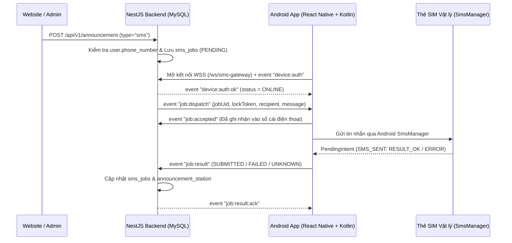

# Tài Liệu Kỹ Thuật: Hệ Thống Trạm Gửi SMS Cá Nhân (Personal SMS Gateway)

Tài liệu này mô tả kiến trúc, cơ sở dữ liệu, giao thức WebSocket, các REST API và cách tích hợp tính năng gửi SMS qua thẻ SIM vật lý của điện thoại Android trong dự án **Academy Backend (`academy`)**.

---

## 1. Tổng quan Kiến trúc

Hệ thống cho phép website/backend gửi tin nhắn SMS thông qua chiếc điện thoại Android của người quản trị mà **không cần thuê dịch vụ SMS Brandname/Gateway bên thứ ba** và **không cần dùng Redis/BullMQ**:

1. **Hàng đợi bền vững bằng MySQL (`sms_jobs`):** Mọi yêu cầu gửi SMS (từ `AnnouncementStation` hoặc API trực tiếp) đều được lưu vào bảng `sms_jobs` với trạng thái ban đầu là `PENDING`.
2. **Kết nối chủ động từ Android qua WebSocket (`ws` / `wss`):**
   - Ứng dụng Android **không chạy ngầm**. Khi người dùng mở ứng dụng và bấm **Khởi động Kết nối**, ứng dụng mở kết nối WebSocket tới endpoint `/ws/sms-gateway` và xác thực bằng `deviceId` + `deviceSecret`.
   - Khi thiết bị đang `ONLINE`, backend tự động khóa nguyên tử (`atomic claim`) từng job `PENDING` và đẩy xuống điện thoại qua sự kiện `job:dispatch`.
   - Khi người dùng đóng ứng dụng hoặc ngắt kết nối, thiết bị chuyển về `OFFLINE`, các job chưa gửi vẫn giữ nguyên trạng thái `PENDING` trong MySQL cho đến khi thiết bị kết nối lại.
3. **Chống gửi trùng SMS (Idempotency & Ambiguity Protection):**
   - Mỗi lần lấy job sử dụng câu lệnh cập nhật nguyên tử có điều kiện `WHERE id = :id AND status = 'PENDING' AND device_id IS NULL`.
   - Mỗi thiết bị chỉ xử lý tối đa **1 job tại một thời điểm** (`inFlightCount === 0`) và tuân thủ giới hạn tốc độ (`rate_limit_per_minute`, `daily_limit`).



---

## 2. Cấu trúc Thư mục Module

```text
src/modules/sms-gateway/
├── dtos/
│   ├── create-sms-job.dto.ts         # DTO tạo yêu cầu gửi SMS
│   ├── paginate-sms-device.dto.ts    # DTO phân trang danh sách thiết bị
│   ├── paginate-sms-job.dto.ts       # DTO phân trang lịch sử job SMS
│   ├── register-sms-device.dto.ts    # DTO đăng ký thiết bị Android mới
│   └── update-sms-device.dto.ts      # DTO cập nhật cấu hình/hạn mức thiết bị
├── entities/
│   ├── sms-device.entity.ts          # Bảng sms_devices
│   └── sms-job.entity.ts             # Bảng sms_jobs
├── sms-gateway.controller.ts         # REST Controllers (Admin & Enqueue/Status)
├── sms-gateway.module.ts             # Khai báo Module
├── sms-gateway.service.ts            # Xử lý nghiệp vụ thiết bị, hàng đợi & đồng bộ trạng thái
├── sms-gateway.ws.ts                 # WebSocket Gateway (/ws/sms-gateway)
└── sms-gateway.spec.ts               # Unit tests cho Service & WebSocket Gateway
```

---

## 3. Thiết kế Cơ sở Dữ liệu (MySQL)

### 3.1. Bảng `sms_devices` ([sms-device.entity.ts](../src/modules/sms-gateway/entities/sms-device.entity.ts))
Lưu danh sách thiết bị Android được phép kết nối làm trạm gửi SMS:
- `device_id` (`varchar(64)`, unique): Mã định danh thiết bị (VD: `android-sim-01`).
- `name` (`varchar(120)`): Tên gợi nhớ của thiết bị.
- `secret_hash` (`varchar(255)`): Mã băm `bcrypt` của `deviceSecret` (không bao giờ lưu plaintext trong DB).
- `status` (`enum: ONLINE | OFFLINE`): Trạng thái kết nối hiện tại.
- `is_active` (`boolean`): Cho phép hoặc khóa thiết bị.
- `rate_limit_per_minute` (`int`, mặc định `10`): Số SMS tối đa gửi trong 1 phút.
- `daily_limit` (`int`, mặc định `200`): Số SMS tối đa gửi trong 1 ngày.
- `sim_sub_id`, `app_version`, `last_ip`, `last_seen_at`, `last_connected_at`, `last_disconnected_at`.

### 3.2. Bảng `sms_jobs` ([sms-job.entity.ts](../src/modules/sms-gateway/entities/sms-job.entity.ts))
Lưu hàng đợi và lịch sử tin nhắn SMS:
- `job_uid` (`varchar(36)`, unique): UUID định danh duy nhất của job.
- `idempotency_key` (`varchar(128)`, unique, nullable): Khóa chống tạo trùng job từ phía gọi API.
- `recipient` (`varchar(32)`): Số điện thoại người nhận đã chuẩn hóa.
- `message` (`text`): Nội dung tin nhắn SMS.
- `status` (`enum`):
  - `PENDING`: Đang nằm trong hàng đợi chờ thiết bị `ONLINE`.
  - `PROCESSING`: Đã giao cho thiết bị Android xử lý.
  - `SUBMITTED`: Điện thoại báo đã gửi lên nhà mạng thành công (`RESULT_OK` cho tất cả các phần tin nhắn).
  - `DELIVERED`: Nhận được báo cáo `SMS_DELIVERED` từ nhà mạng (nếu hỗ trợ).
  - `FAILED`: Gửi thất bại hoàn toàn (chưa có phần nào phát đi thành công).
  - `UNKNOWN`: Kết quả không chắc chắn (ví dụ: tin nhắn nhiều phần chỉ gửi được một số phần, hoặc mất kết nối sau khi đã dispatch). **Không tự động gửi lại** để tránh lặp tin nhắn.
- `device_id`, `lock_token`, `lock_version`, `dispatch_attempts`.
- `parts_total`, `parts_sent`, `parts_failed`, `parts_delivered`, `part_results` (`json`).
- `metadata` (`json`): Lưu thông tin liên kết (như `announcementId`, `userId`, `role`).

---

## 4. Tích hợp với `AnnouncementStation`

Trong [announcement-station.service.ts](../src/modules/announcement-station/announcement-station.service.ts):
- Khi gọi `POST /api/v1/announcement` với `"type": "sms"`:
  1. **Không bắt buộc `file_url`**: DTO [announcement.dto.ts](../src/modules/announcement-station/dtos/announcement.dto.ts) tự động bỏ qua kiểm tra `file_url` khi `type === 'sms'`.
  2. **Kiểm tra số điện thoại (`user.phone_number`)**: Hệ thống truy vấn số điện thoại của các học viên (`Role.STUDENT`) hoặc giảng viên (`Role.TEACHER`) trong `userIds`. Nếu không có người nhận nào có số điện thoại hợp lệ, trả về mã lỗi `400 NO_PHONE_NUMBER_FOUND` (`"Không tìm thấy số điện thoại người nhận"`).
  3. **Đẩy vào hàng đợi & Đồng bộ trạng thái**:
     - Lưu bản ghi vào bảng `announcement_station` kèm `phone_number` và `sms_job_uid`.
     - Khi `SmsGatewayService` chuyển trạng thái job (`PROCESSING` → `SUBMITTED` / `FAILED` / `UNKNOWN`), trạng thái tương ứng trong bảng `announcement_station` được tự động cập nhật theo thời gian thực.

---

## 5. Danh sách REST API

Tất cả các endpoint đều yêu cầu JWT Bearer Token (`ADMIN` hoặc `SUPER_ADMIN`).

### 5.1. Quản lý Thiết bị (`/api/v1/admin/sms-gateway/devices`)
| Phương thức | Endpoint | Mô tả |
| :--- | :--- | :--- |
| `POST` | `/api/v1/admin/sms-gateway/devices/register` | Đăng ký thiết bị mới. Trả về `deviceSecret` (64 ký tự hex) **duy nhất 1 lần** để nhập vào app Android. |
| `GET` | `/api/v1/admin/sms-gateway/devices` | Danh sách thiết bị kèm trạng thái kết nối thực tế (`is_socket_connected`) và thống kê lưu lượng (`usage`). |
| `PUT` | `/api/v1/admin/sms-gateway/devices/:id` | Cập nhật tên, số điện thoại, trạng thái kích hoạt (`is_active`), giới hạn phút/ngày. |
| `POST` | `/api/v1/admin/sms-gateway/devices/:id/rotate-secret` | Cấp lại `deviceSecret` mới và ngắt kết nối phiên hiện tại của thiết bị. |

### 5.2. Quản lý Hàng đợi SMS Job
| Phương thức | Endpoint | Mô tả |
| :--- | :--- | :--- |
| `POST` | `/api/v1/sms-gateway/jobs` | Đưa 1 tin nhắn SMS mới vào hàng đợi. |
| `GET` | `/api/v1/sms-gateway/jobs/:idOrUid` | Tra cứu trạng thái chi tiết của 1 SMS job theo `id` hoặc `job_uid`. |
| `GET` | `/api/v1/admin/sms-gateway/jobs` | Phân trang và lọc lịch sử SMS job. |
| `GET` | `/api/v1/admin/sms-gateway/stats` | Thống kê tổng số lượng job theo từng trạng thái. |

---

## 6. Cấu hình Môi trường & Reverse Proxy (Nginx WSS)

### 6.1. Biến môi trường (`.env`)
```env
PORT=5000
SMS_WS_PATH=/ws/sms-gateway
SMS_RATE_LIMIT_PER_MINUTE=10
SMS_DAILY_LIMIT=200
```

### 6.2. Cấu hình Nginx cho kết nối bảo mật `wss://` trên Ubuntu VPS
Khi triển khai trên VPS sử dụng HTTPS (Let's Encrypt / Certbot), thêm khối `location /ws/sms-gateway` vào cấu hình Nginx của domain:

```nginx
location /ws/sms-gateway {
    proxy_pass http://127.0.0.1:5000/ws/sms-gateway;
    proxy_http_version 1.1;
    proxy_set_header Upgrade $http_upgrade;
    proxy_set_header Connection "upgrade";
    proxy_set_header Host $host;
    proxy_set_header X-Real-IP $remote_addr;
    proxy_set_header X-Forwarded-For $proxy_add_x_forwarded_for;
    proxy_set_header X-Forwarded-Proto $scheme;

    # Giữ kết nối WebSocket ổn định (app gửi heartbeat mỗi 20s)
    proxy_read_timeout 90s;
    proxy_send_timeout 90s;
}
```

